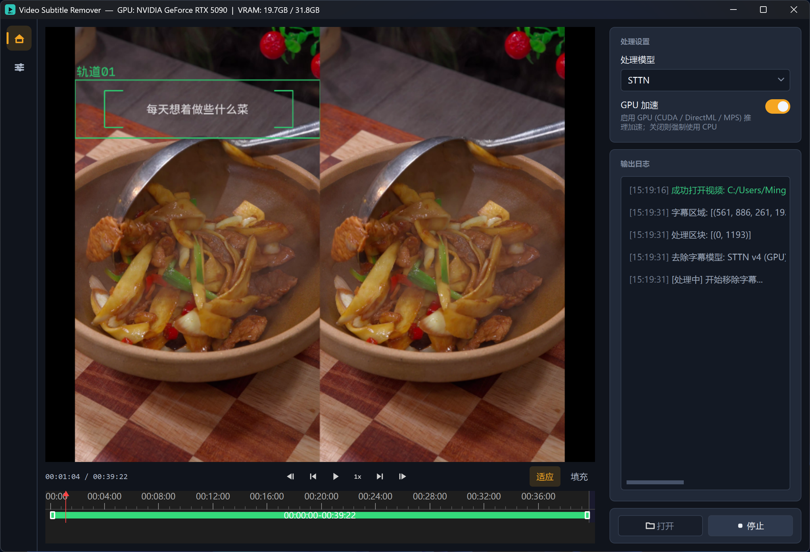

简体中文 | [English](README_en.md)

<div align="center">
  
</div>

## 项目简介


Video-subtitle-remover (VSR) 是一款基于 AI 视频修复技术的硬字幕去除工具。它在 **STTN、E2FGVI、ProPainter**
三种开源视频补全模型的基础上二次训练，针对字幕与文字水印场景做了专项优化，以原分辨率填充字幕区域并生成无字幕视频。

主要功能：
- 无损分辨率去除硬字幕 / 文字水印，内置三种可切换的修复模型
- 在预览画面上拖拽框选字幕区域，或用轨道式时间轴精确控制处理区间
- 处理中实时预览原片与结果对比，支持逐帧、变速播放与快捷键操作
- PyQt6 现代界面，参数均可在设置面板中调整，无需手动改配置文件

> **说明**：本项目与 [YaoFANGUK/video-subtitle-remover](https://github.com/YaoFANGUK/video-subtitle-remover)
> 是同名但相互独立的项目，二者并非同一项目。



**使用说明：**
- 直接下载压缩包解压运行，如果不能运行再按照下面的教程，尝试源码安装环境运行

## 源码使用说明

**建议调用 AI Agent（如 Claude Code、Codex、Cursor 等）一键部署**：把本仓库交给它，
让它按 `requirements.txt` 自动安装 Python 3.12+ 与 CUDA 版 PyTorch 依赖，无需手动逐步配置环境。

环境就绪后，运行图形界面：

```shell
python gui.py
```

> 最简单的方式仍是直接下载压缩包解压运行，无需部署环境。

## 常见问题

三种处理模型怎么切换

`Main -> InpaintMode` 可选择 `STTN`、`E2FGVI`、`ProPainter`。三者均为本地内嵌推理，
本项目使用的 STTN / E2FGVI / ProPainter 权重均为在开源模型基础上的**二次训练**版本，
针对硬字幕场景做了优化。权重随压缩包分发，源码部署时可借助 AI Agent 自动获取；如需替换权重，可在 `Models` 配置段指定：

```json
"Models": {
  "STTNCheckpoint": "core/inpaint/models/sttn/sttn.pt",
  "E2FGVICheckpoint": "core/inpaint/models/e2fgvi/e2fgvi.pth",
  "ProPainterCheckpoint": "core/inpaint/models/propainter/propainter.pt"
}
```

路径均为**相对项目根目录**，换机器部署无需修改。

   ProPainter 还需要同目录下的 `raft-things.pth` 光流权重（默认自动查找）。
   三个模型都会按当前选区裁剪后推理，再只把该区域写回；AB 区间外恢复原视频。

## 致谢

本项目的模型能力建立在以下优秀开源项目之上，感谢原作者与社区：

- [STTN (Spatial-Temporal Transformer Network)](https://github.com/researchmm/STTN)
- [E2FGVI (End-to-End Framework for Video Inpainting)](https://github.com/ML-GSAI/E2FGVI)
- [ProPainter](https://github.com/sczhou/ProPainter)

## 使用声明

本项目仅供个人学习与研究使用，**非商业用途**。如需商业使用，请联系作者获得授权。


