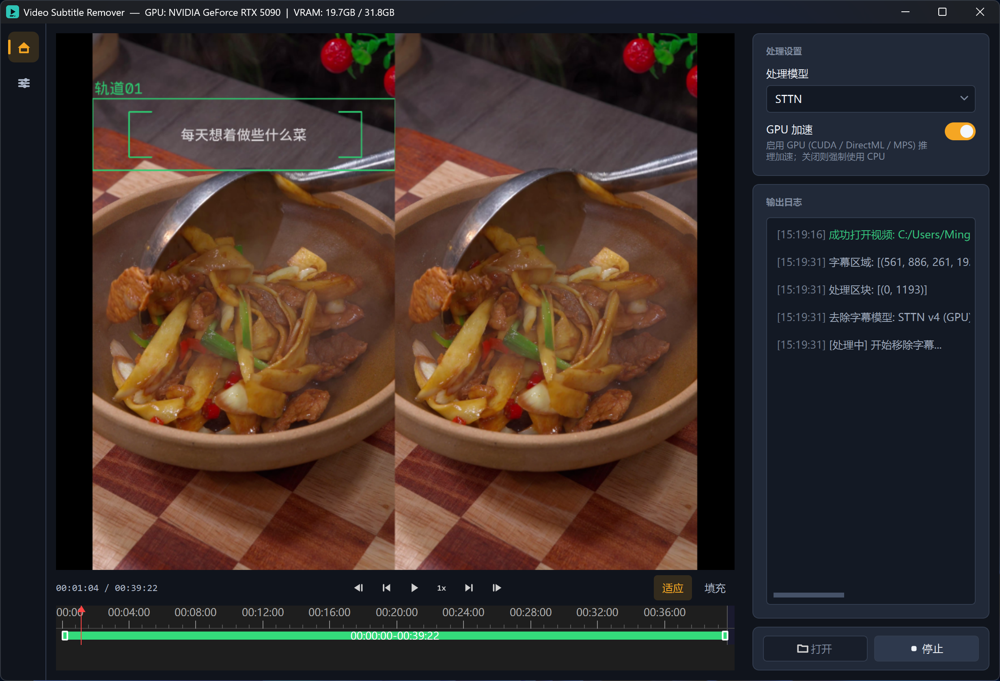

[简体中文](README.md) | English

## Project Introduction


Video-subtitle-remover (VSR) is an AI video-inpainting tool that removes hardcoded subtitles from videos.
It is built on **retrained versions of three open-source video completion models — STTN, E2FGVI, and ProPainter**,
optimized specifically for subtitle and text-watermark scenarios. It fills subtitle areas at the original
resolution and produces subtitle-free videos.

Key features:
- Lossless-resolution removal of hardcoded subtitles / text watermarks, with three switchable inpainting models
- Drag to select subtitle areas on the preview, or use a track-based timeline for precise range control
- Real-time original/result comparison during processing, with frame-by-frame and variable-speed playback
- Modern PyQt6 UI with an advanced settings panel — adjust parameters without editing config files



**Usage:**
- Download the prebuilt archive and run it directly. If that doesn't work, follow the source-deployment guide below.

## Source Code Usage

**It is recommended to use an AI Agent (e.g. Claude Code, Codex, Cursor) for one-click deployment**:
hand it this repository and let it install Python 3.12+ and the CUDA PyTorch dependencies from
`requirements.txt` automatically — no need to configure the environment step by step.

Once the environment is ready, launch the GUI:

```shell
python gui.py
```

> The simplest option is still to download the prebuilt archive and run it directly, with no environment setup.

## FAQ

How to switch between the three models

Select `STTN`, `E2FGVI`, or `ProPainter` under `Main -> InpaintMode`. All three run locally with
embedded inference. The STTN / E2FGVI / ProPainter weights shipped with this project are
**retrained** versions of the open-source models, optimized for hardcoded-subtitle scenarios.
To replace the weights, edit the `Models` section:

```json
"Models": {
  "STTNCheckpoint": "core/inpaint/models/sttn/sttn.pt",
  "E2FGVICheckpoint": "core/inpaint/models/e2fgvi/e2fgvi.pth",
  "ProPainterCheckpoint": "core/inpaint/models/propainter/propainter.pt"
}
```

Paths are relative to the project root, so no changes are needed when deploying on another machine.

ProPainter additionally needs the `raft-things.pth` optical-flow weight in the same directory
(found automatically by default). All three models crop to the selected area for inference and
write back only that region; areas outside the AB sections are restored from the original video.

## Acknowledgements

This project builds upon the following excellent open-source projects. Thanks to the original
authors and communities:

- [STTN (Spatial-Temporal Transformer Network)](https://github.com/researchmm/STTN)
- [E2FGVI (End-to-End Framework for Video Inpainting)](https://github.com/ML-GSAI/E2FGVI)
- [ProPainter](https://github.com/sczhou/ProPainter)

## Usage Notice

This project is intended for **personal study and research only — non-commercial use**.
For commercial use, please contact the author for authorization.
